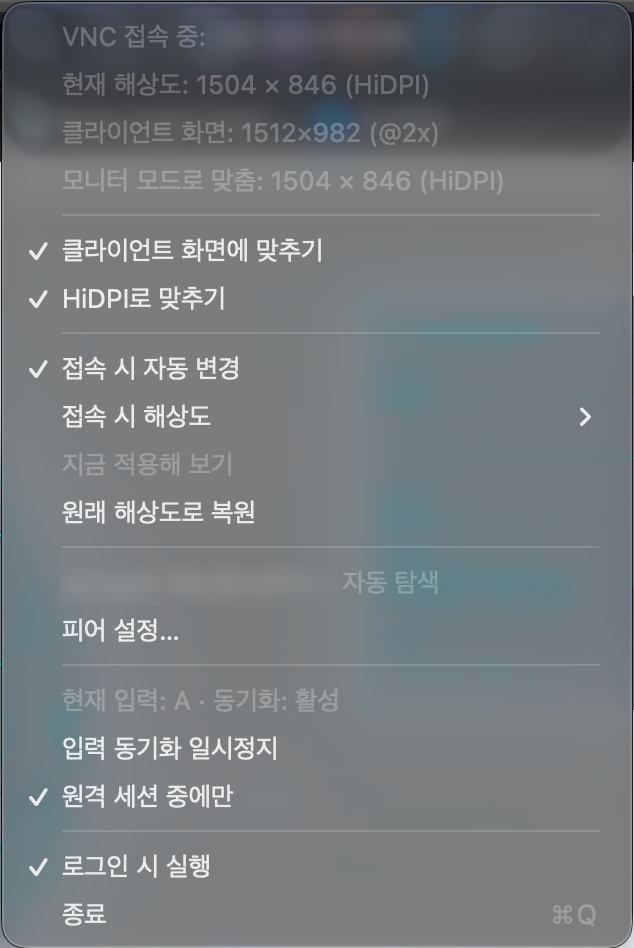
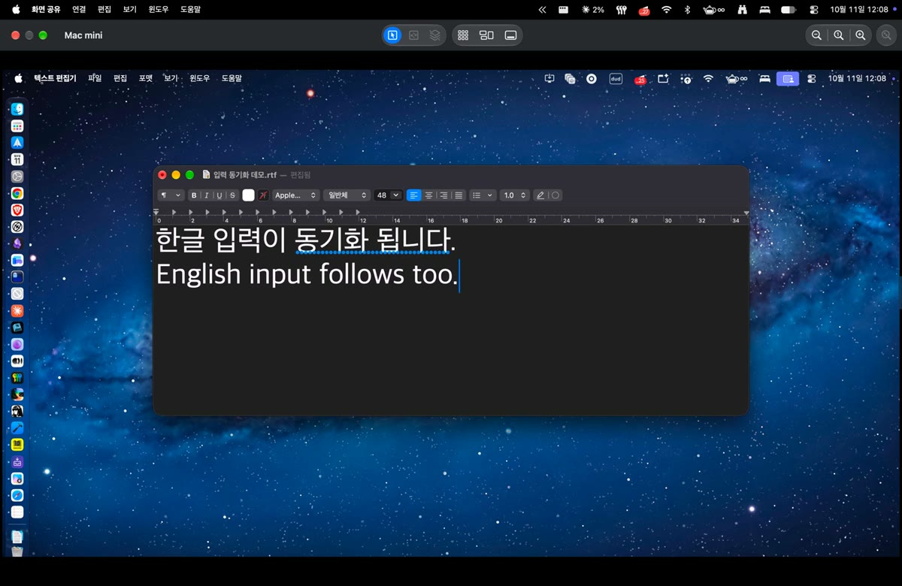

# VNCAutoResolution

**English** | [한국어](README.md)

[](https://github.com/jeongsk/VNCAutoResolution/actions/workflows/test.yml)

A macOS menu bar app that removes two annoyances of connecting from a MacBook to a Mac mini over Screen Sharing (VNC).

> Note: the app's interface is currently Korean only. This README quotes menu items and messages in the original Korean, with an English gloss in parentheses.

- **Automatic resolution change**: when a VNC connection comes in to the Mac mini, it switches to a target resolution you picked in advance, and restores the original resolution when the connection ends.
- **Fit to client screen**: matches the screen size reported by the MacBook app. If a monitor is attached, it changes the monitor's resolution; if not, it sizes a virtual display to the MacBook's screen.
- **Sharp even in standard quality (HiDPI scale-up)**: connecting with Screen Sharing in standard quality (not High Performance mode) makes text look blurry on the MacBook's Retina display. On connect, the Mac mini's screen is automatically drawn at 2x pixels (HiDPI) to match the MacBook's scale, so it stays sharp in standard quality. Example: a 1512×982 screen is drawn at 3024×1964 pixels. Because this increases the amount of data sent, toggle it with **HiDPI로 맞추기** (Fit with HiDPI) in the menu.
- **Korean/English input sync**: during a remote session, keeps the Korean/English input source of both Macs in sync in both directions. This prevents Korean text from being split into individual jamo.

> License: [MIT](LICENSE). You may use, modify, and distribute it freely for personal, work, or commercial purposes. See [License](#license) below for details.

<p align="center"></p>

<p align="center"><a href="https://github.com/jeongsk/VNCAutoResolution/releases/download/v1.0.0/VNCAutoResolution-demo.mp4"></a><br><a href="https://github.com/jeongsk/VNCAutoResolution/releases/download/v1.0.0/VNCAutoResolution-demo.mp4">▶ Demo video (1 min)</a>: fitting the screen, toggling HiDPI, Korean/English input sync</p>

Install the same app on both Macs. There is no role setting.

| Role | Example | Features that run |
| --- | --- | --- |
| Host Mac | Mac mini (the side with Screen Sharing on) | Automatic resolution change + input sync |
| Client Mac | MacBook (the side that connects) | Input sync (there are no incoming port 5900 connections, so the resolution features stay off on their own) |

## Requirements

- macOS 13 or later (universal binary supporting both Apple Silicon and Intel)
- Xcode or Command Line Tools on the Mac that builds the app

```sh
xcode-select --install   # if Command Line Tools are not installed
```

## Download

Download `VNCAutoResolution.zip` from [Releases](https://github.com/jeongsk/VNCAutoResolution/releases/latest), unzip it and move the app to `/Applications`. The app is not notarized, so macOS warns you the first time you open it; see [After moving to another Mac](#after-moving-to-another-mac-gatekeeper) below for how to open it. Release builds are ad-hoc signed, so their signature differs from an app you build yourself and macOS may ask for permissions again.

## Build and install

```sh
git clone https://github.com/jeongsk/VNCAutoResolution.git
cd VNCAutoResolution
./build.sh
```

This produces `build/VNCAutoResolution.app`. If the universal (arm64 + x86_64) build fails, it rebuilds for the current architecture only. If the keychain has an "Apple Development" certificate, the app is signed with it; otherwise it is ad-hoc signed. To use a different certificate, specify it with `SIGN_IDENTITY="certificate name" ./build.sh`.

Copy it to `/Applications` and run it.

```sh
cp -R build/VNCAutoResolution.app /Applications/
open /Applications/VNCAutoResolution.app
```

A display icon appears in the menu bar, with no Dock icon. The icon changes while a VNC connection is active.

### After moving to another Mac (Gatekeeper)

If you move an app built on one Mac to another Mac via AirDrop, a messenger, a shared folder, etc., an "unidentified developer" warning appears and the app won't run, because the app is not notarized. Resolve it in one of two ways.

```sh
# Method 1: remove the quarantine attribute
xattr -dr com.apple.quarantine /Applications/VNCAutoResolution.app
```

Method 2: In Finder, right-click the app and choose "열기" (Open), then click "열기" (Open) again in the warning dialog. If it is still blocked, click "그래도 열기" (Open Anyway) at the bottom of System Settings > 개인정보 보호 및 보안 (Privacy & Security).

The simplest approach is to run `./build.sh` on each of the two Macs. In that case the quarantine attribute is not attached.

## First launch

### Local network permission

On first launch, the app asks for the "로컬 네트워크에 있는 기기 찾기 및 연결" (Find and connect to devices on your local network) permission. It is needed to automatically discover and connect to the other Mac on the same router, so **allow** it. You can change it later under System Settings > 개인정보 보호 및 보안 (Privacy & Security) > 로컬 네트워크 (Local Network).

> This permission and Keychain access are tied to the app's code signature. With a fixed certificate they persist across rebuilds, but if you **rebuild with an ad-hoc signature, the signature changes and the permission may be requested again.** If the other Mac still isn't found after you allowed it, check in System Settings that the permission is turned on.

### Firewall

If the macOS firewall is on, the first launch may show "들어오는 연결을 허용하시겠습니까?" (Do you want to allow incoming connections?). Allow it. The app listens for connections from the other Mac on TCP port **52718**. If a firewall or router blocks this port, the connection will fail. The Bonjour service type is `_vncautores._tcp`.

### Keychain

The pairing password is stored in the Keychain. If a window asks for Keychain access, allow it.

## Host Mac (Mac mini) setup

### 1. Turn on Screen Sharing

In System Settings > 일반 (General) > 공유 (Sharing), turn on **화면 공유** (Screen Sharing). The app detects connections by checking for connections coming in on port 5900 (ESTABLISHED) about every 2 seconds.

### 2. Choose the target resolution

Open the menu bar icon and set the following.

| Menu item | Description |
| --- | --- |
| `접속 시 자동 변경` (Auto-change on connect) | When on, the resolution changes automatically on a VNC connection. |
| `접속 시 해상도` (Resolution on connect) | The list of resolutions this Mac supports. HiDPI status is shown, as in `1512 × 982 (HiDPI)`. |
| `지금 적용해 보기` (Try applying now) | Tests the target resolution in advance without a connection. |
| `원래 해상도로 복원` (Restore original resolution) | Immediately returns to the resolution from before the connection. |

Pick a size that suits the MacBook's screen. If the network is slow, pick a lower resolution to reduce the amount of data sent. The resolution is applied at session scope only, so it reverts when you log out.

This is how it works.

- When a connection is detected, it saves the current resolution as the "original resolution" and then applies the target resolution.
- The connection counts as ended only when the client list is empty twice in a row (about 4 seconds). A brief drop and reconnect does not trigger a restore.
- If several clients are connected, it restores only when the last client leaves.
- If applying fails because the screen is locked, it retries every 10 seconds, up to 6 times.
- If the app quit during a connection, on the next launch it restores the original resolution if there is no session.

### 3. Mac mini without a monitor

A Mac mini with no monitor attached has only one or two resolution choices. When there are fewer than 4 choices, the menu shows the notice "선택할 수 있는 해상도가 적습니다" (Few resolutions are available). Create a virtual display in one of the following ways.

- **HDMI dummy plug**: a small device that plugs into the HDMI port. It makes the Mac think a monitor is connected, which expands the resolution list. This is the simplest and most stable option.
- **[SimpleDisplay](https://github.com/SamuelRioTz/SimpleDisplay)**: an app that creates a virtual display. Its license is GPL-3.0.
- **[DeskPad](https://github.com/Stengo/DeskPad)**: an app that creates a virtual display and shows it in a window.

When the displays change, the app automatically re-reads the resolution list.

## Pairing and connection

Input sync requires the two Macs to be connected to each other. Open the settings window from **피어 설정…** (Peer settings…) in the menu.

1. **페어링 암호** (Pairing password): Enter the **same password** on both Macs. It is used to authenticate and encrypt communication (TLS-PSK). If the passwords differ, the connection is rejected. The password is stored in the Keychain.
2. **직접 연결할 피어 주소** (Peer address to connect to directly): On the same router, leave it empty and Bonjour discovers the peer automatically. On an external network such as Tailscale or a VPN, enter the other Mac's address.
   - Examples: `100.64.0.2`, `macmini.tailnet-name.ts.net`, `mac.example:52718`
   - If you omit the port, 52718 is used.
   - For a direct address, the side that entered it initiates the connection. Entering it on one side only is fine.
3. Click **저장** (Save).

Once connected, the menu shows `피어 이름 · 자동 탐색` (peer name · auto-discovered) or `피어 이름 · 직접 입력` (peer name · entered directly). If the same peer is reached by two paths, only one connection is kept. Both Macs choose by the same rule (the connection initiated by the side with the smaller device ID; among those, the auto-discovered one), so they don't keep dropping each other's connections. The path that doesn't survive is retried every 30 seconds and then cleaned up right away; this is normal behavior.

If the connection drops, the app reconnects automatically, increasing the interval from 1 second up to 30 seconds. If a connection attempt does not finish within 15 seconds (stuck on Bonjour address lookup or the TLS handshake), it is dropped and retried.

A client Mac with a viewer app (Screen Sharing, etc.) running sends its main screen size to the host Mac at session start, on a new peer connection, and on a display configuration change. The host menu shows it as `클라이언트 화면: 1512×982 (@2x)` (Client screen: 1512×982 (@2x)), and it disappears when the session ends or the connection drops. The host uses this information to fit its screen to the client's size (below).

## Fit to client screen

When the host Mac receives client screen information during a VNC session, it fits its screen to that size and restores it when the session ends. You don't need to pick a target resolution yourself.

1. **If a monitor is attached, it changes the monitor's resolution.** From the resolutions the monitor supports, it picks the largest one that fits within the client screen (in points). It must be at least 70% of the client's width, and it only picks on displays with 4 or more choices. Example: MacBook 1512×982 @2x, 4K monitor → `1504 × 846 (HiDPI)`.
2. **If no resolution fits or there is no monitor, it creates a virtual display.** It creates a virtual screen the same size as the client and uses it for the duration of the session.

| Menu item | Description |
| --- | --- |
| `모니터 모드로 맞춤: 1504 × 846 (HiDPI)` (Fitted in monitor mode: 1504 × 846 (HiDPI)) | The state where the monitor's resolution was changed to fit. |
| `가상 디스플레이: 사용 중 1512×982` (Virtual display: in use 1512×982) / `대기` (idle) / `사용 불가` (unavailable) | Virtual display status. The size is read via `CGDisplayBounds`. `사용 불가` (unavailable) means this macOS cannot create a virtual display; other features keep working. |
| `클라이언트 화면에 맞추기` (Fit to client screen) | On by default. When off, it does not fit and works with the existing `접속 시 해상도` (Resolution on connect). |
| `HiDPI로 맞추기` (Fit with HiDPI) | Off by default. When on, a monitor uses only HiDPI resolutions, and a virtual display is created in a 2x-pixel HiDPI mode (1512×982 @2x → 3024×1964 pixels). Sharper, but more data is sent. Measured example: about 1 MB → 3 MB per 10 seconds while the screen is moving. A 1x client is unaffected. |
| `정리되지 않은 가상 화면 N개가 남아 있습니다…` (N uncleaned virtual screens remain…) | Shown only when virtual displays that were removed still remain in the system (see Known limitations below). |

The virtual display follows these rules.

- All of the following conditions must be met to create one: the feature is on, there is a VNC session on this Mac, client screen information is available, the feature is available, and there is no Screen Sharing high-performance-mode virtual display ("Screen Sharing Virtual Display").
- When the session ends (not detected twice in a row, the same criterion as resolution restore), the virtual display is removed. If the client screen size changes, the mode is changed.
- **While a virtual display exists, the `접속 시 해상도` (Resolution on connect) feature is paused.** It does not apply, restore, retry, or react to display changes. If there is no client screen information (for example, the MacBook app is off), it works with the existing target resolution.
- If client screen information arrives late during a session, the target resolution that was already applied is reverted to the original and then the virtual display is created. If only the screen information disappears after the virtual display was created (session signal expired, peer connection dropped), the last size is kept and the display is removed when the session ends. If `클라이언트 화면에 맞추기` (Fit to client screen) is turned off during a session, the virtual display is removed and replaced by the target resolution.
- If virtual display creation fails, it retries every 10 seconds, up to 3 times, and works with the target resolution in the meantime.
- The app holds the virtual display. If the app quits or is force-quit, the system removes it and the original screen returns (for the rare case where it remains, see Known limitations). It is never created as a mirror of any display.
- After the virtual display is removed, it waits 3 seconds before restoring the resolution. When the display configuration changes, macOS reapplies the resolution it remembered for that configuration, so restoring immediately would be overwritten.
- It finds and uses the private CoreGraphics API (`CGVirtualDisplay`) at runtime. If a macOS update changes it, the state may become `사용 불가` (unavailable). The class declaration was based on [DeskPad](https://github.com/Stengo/DeskPad) (MIT) ([THIRD_PARTY_NOTICES.md](THIRD_PARTY_NOTICES.md)).

## Korean/English input sync

| Menu item | Description |
| --- | --- |
| `현재 입력: 한 · 동기화: 활성` (Current input: Korean · Sync: active) | The current input state (한/A, i.e. Korean/English) and the sync state (활성/대기/일시정지, i.e. active/idle/paused). |
| `입력 동기화 일시정지` (Pause input sync) / `재개` (Resume) | Pauses or resumes sync. |
| `원격 세션 중에만` (Only during remote sessions) | When on (default), syncs only during a remote session. When off, always syncs. |

"During a remote session" means any one of the following.

- A VNC connection is coming in to this Mac.
- A remote viewer app (Screen Sharing, Screens, Jump Desktop, VNC Viewer, etc.) is running on this Mac.
- The other Mac has reported that its session is active (within the last 10 minutes).

When a session starts, the other side is aligned once to the input state of the side viewing the viewer (the client Mac). Even if the two Macs use different Korean input methods (for example, 2-Set Korean and Gureum), it substitutes by language to match them, and for English it prefers ABC.

## Launch at login

Turn on **로그인 시 실행** (Launch at login) in the menu. The app starts on its own even when the Mac mini reboots. It works only when run as the `.app` bundle installed in `/Applications`. On failure, the menu shows the message "로그인 항목 설정 실패: …" (Failed to set login item: …).

## Manual test checklist for two Macs

Actual display changes, input source switching, and the flow between the two Macs are not verified by automated tests. After installing, check the items below yourself. The host is the Mac mini and the client is the MacBook.

### Preparation

- [ ] The app is installed and running on both Macs. The icon shows in the menu bar.
- [ ] Both Macs have allowed the local network permission.
- [ ] Screen Sharing is on at the host.
- [ ] In the host menu, `접속 시 자동 변경` (Auto-change on connect) is on and a `접속 시 해상도` (Resolution on connect) different from the current one is chosen.
- [ ] On the host, `지금 적용해 보기` (Try applying now) changes the resolution, and `원래 해상도로 복원` (Restore original resolution) brings it back.

### Resolution

- [ ] **Connect -> change**: When the client connects via Screen Sharing, the host resolution changes to the target resolution within a few seconds. The host menu shows `VNC 접속 중: <클라이언트 주소>` (VNC connected: <client address>).
- [ ] **Disconnect -> restore**: When the connection is dropped, the host resolution returns to the original after about 4 seconds. The menu shows "접속 해제 → 원래 해상도 복원" (Disconnected -> original resolution restored).
- [ ] **Locked screen**: Connect while the host screen is locked. If the first apply fails, the menu shows "…초 뒤 재시도" (retry in … seconds), and the target resolution is applied once you unlock.
- [ ] **Restore after app restart**: While connected (resolution changed), quit the host app and drop the connection. When you launch the app again, the original resolution is restored.
- [ ] Connecting from the client (MacBook) to another Mac does not change the MacBook's resolution.
- [ ] If two clients connect at the same time and only one disconnects, no restore happens; it restores when the last one disconnects.
- [ ] (Mac mini without a monitor) With fewer than 4 choices, the menu shows the notice about too few resolutions. Connecting a dummy plug or virtual display expands the list.

### Virtual display (Fit to client screen)

Check these with `클라이언트 화면에 맞추기` (Fit to client screen) on in the host menu and the two Macs paired and connected.

- [ ] **Connect -> client size**: When the MacBook connects via Screen Sharing, the host screen changes within a few seconds to the MacBook's screen size (the same size as `클라이언트 화면` (Client screen) in the menu), and only one screen shows in the Screen Sharing window. The host menu shows `가상 디스플레이: 사용 중 W×H` (Virtual display: in use W×H).
- [ ] **Disconnect -> restore**: When the connection is dropped, the virtual display disappears after about 4 seconds and the host returns to its original screen (for example, 1920×1080). The menu goes to `대기` (idle).
- [ ] **Force-quit app -> restore**: Force-quitting the host app during a connection (via Activity Monitor) makes the virtual display disappear and the original screen returns.
- [ ] **Follows size changes**: Changing the MacBook's resolution during a connection changes the host virtual display size to match.
- [ ] **HiDPI**: Turn on `HiDPI로 맞추기` (Fit with HiDPI) and connect again; the host screen looks sharp at the same point size.
- [ ] **Turning the feature off**: Connecting with `클라이언트 화면에 맞추기` (Fit to client screen) off does not create a virtual display and works with `접속 시 해상도` (Resolution on connect).
- [ ] **No conflict with the resolution feature**: While a virtual display exists, `지금 적용해 보기` (Try applying now) and `원래 해상도로 복원` (Restore original resolution) are disabled, and after the connection is dropped the host resolution has not been changed to something unexpected.
- [ ] **MacBook app off**: Connecting with the MacBook app off shows `대기` (idle) and works with the existing target resolution.
- [ ] **Monitor mode**: Connecting to a host with a monitor attached changes the monitor resolution to fit the client without a virtual display (`모니터 모드로 맞춤` (Fitted in monitor mode)), and disconnecting returns it to the original resolution.

### Input sync

- [ ] **Two-way Korean/English**: During a remote session, switching Korean/English on the client puts the host in the same state, and switching on the host makes the client follow.
- [ ] **No echo loop**: After switching Korean/English once, the input state of both Macs stays stable for a few seconds without continuing to change. Even after several rapid switches, it converges to the last state.
- [ ] **Different Korean input methods**: When the two Macs use different Korean input methods (for example, 2-Set on one and Gureum on the other), Korean/English switching matches by falling back to language.
- [ ] When not in a remote session (viewer app closed, no connection) and `원격 세션 중에만` (Only during remote sessions) is on, the input state is not synced.
- [ ] Pressing `입력 동기화 일시정지` (Pause input sync) stops syncing, and `재개` (Resume) makes it work again.

### Connection

- [ ] **Auto-discovery**: On the same router, with the address empty and the same password entered, each Mac's menu shows the other's name and `자동 탐색` (auto-discovered).
- [ ] **Direct connection to an external address**: From another network (Tailscale/VPN), entering the other Mac's address in `직접 연결할 피어 주소` (Peer address to connect to directly) connects as `직접 입력` (entered directly).
- [ ] **Wrong password rejected**: Changing the pairing password on one side prevents the connection, and input sync doesn't work either. Matching the password again connects.
- [ ] Briefly disconnecting and reconnecting the network reconnects automatically.

### Installation

- [ ] **Launch at login**: With `로그인 시 실행` (Launch at login) turned on at the host, the app starts on its own after a reboot.
- [ ] An app copied to another Mac runs via `xattr` or right-click > Open.

## Known limitations and next steps

### Verifying dynamic resolution (next step)

[bhicks329/resolution-fixer](https://github.com/bhicks329/resolution-fixer) changes the resolution the same way (watching port 5900) and also turns on **Dynamic Resolution** via a private SkyLight API. If the resolution follows the window size even in regular (non-high-performance) Screen Sharing, you would no longer need to pick a target resolution yourself.

However, Apple's documentation says Dynamic Resolution is **for High Performance connections only**. So first confirm the actual behavior with resolution-fixer, and if it works, consider adding it as an optional feature in a follow-up spec. For now, Fit to client screen (monitor resolution or virtual display) is used instead. resolution-fixer has no license, so no code was taken from it; only the ideas (retrying on a locked screen, restoring at startup) were referenced.

### Known limitations

- **It does not distinguish failure reasons.** When a resolution change or restore fails, the menu lumps together the possible reasons, such as "잠긴 화면이거나 지원하지 않는 해상도일 수 있음" (The screen may be locked or the resolution unsupported).
- **It only keeps retrying when the saved original resolution ID is gone.** If the display configuration changed between connections (a monitor or dummy plug was swapped) and the saved original resolution is no longer in the list, the restore retries with the same ID and then gives up. In this case `원래 해상도로 복원` (Restore original resolution) may keep failing, so change it manually in System Settings.
- **There is no hello timeout.** After connecting, if the other side doesn't send `hello` and just sits idle, the connection is not dropped. There is a TCP connection timeout (5 seconds) and keepalive (30 seconds).
- Bonjour auto-discovery on macOS 15 or later requires `NSBonjourServices` and the local network permission to line up.
- **On a Mac without a monitor, a virtual display sometimes is not removed and remains ([#13](https://github.com/jeongsk/VNCAutoResolution/issues/13)).** It appears that WindowServer cannot find the target to remove; the conditions have not been pinned down yet. When it remains, the menu shows a warning, and it goes away when you connect a monitor (or a dummy plug).
- **The launch-at-login toggle has not been verified in a real environment either.**
- There are reports that switching the input source (`TISSelectInputSource`) is sometimes not reflected from an inactive app.
- Fit to client screen is based on a single client. Several simultaneous clients and Screen Sharing high-performance mode are not supported. If you turn on a monitor during a session, a virtual display that was already created remains as an extended display until the session ends. It does not set a main display or mirror.
- Virtual display creation and mode changes have not been automatically tested (verified with the manual checklist above). In environments where the client app can't be used (Windows/Linux clients), there is no screen information, so it works with the target resolution.
- The app is not notarized and is not distributed through the App Store. Windows/Linux clients are not supported.

## Credits and licenses

- The input source fallback rules, echo suppression, viewer app list, session signal validity period, and TCP tuning for input sync were ported from the approach of [HangulSync](https://github.com/catgarret/HangulSync) (MIT). The copyright notice is in [THIRD_PARTY_NOTICES.md](THIRD_PARTY_NOTICES.md).
- [remote-input-sync](https://github.com/firejune/remote-input-sync) (MIT) is a project that solves the same problem with Karabiner and SSH. **It was only an inspiration; no code was used.**
- The `CGVirtualDisplay` class declaration used for the virtual display was based on [DeskPad](https://github.com/Stengo/DeskPad) (MIT). The copyright notice is in [THIRD_PARTY_NOTICES.md](THIRD_PARTY_NOTICES.md).
- [resolution-fixer](https://github.com/bhicks329/resolution-fixer) was referenced for ideas only (see above).

## License

This project is licensed under the [MIT License](https://opensource.org/license/mit). The full text is in [LICENSE](LICENSE).

You may use, copy, modify, redistribute, and sell it for any purpose, personal, work, or commercial. When distributing it, include the copyright notice and the license text. The software is provided "as is", without warranty of any kind.

Third-party code included in this project (HangulSync, DeskPad, MIT) remains under its own license, and the notices are in [THIRD_PARTY_NOTICES.md](THIRD_PARTY_NOTICES.md).

The specs are in [docs/specs/0001-remote-mac-companion.md](docs/specs/0001-remote-mac-companion.md) and [docs/specs/0002-client-matched-virtual-display.md](docs/specs/0002-client-matched-virtual-display.md) (written in Korean).
