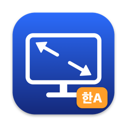
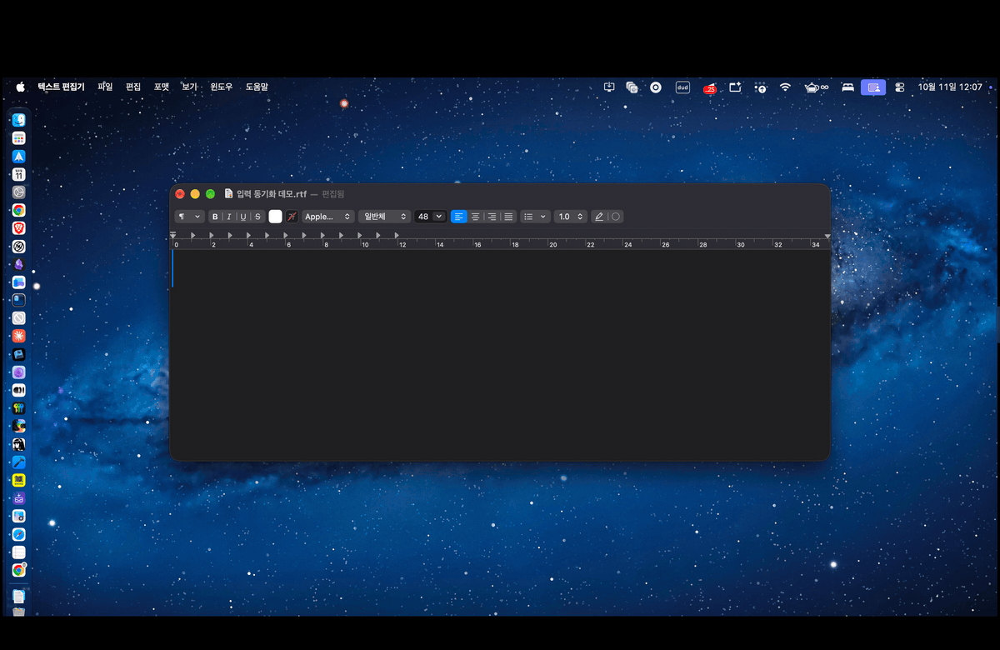

<p align="center"></p>

# VNCAutoResolution

[English](README.en.md) | **한국어**

[](https://github.com/jeongsk/VNCAutoResolution/actions/workflows/test.yml)

맥북에서 화면 공유(VNC)로 맥미니에 접속할 때 생기는 불편을 줄여 주는 macOS 메뉴바 앱입니다.

- **해상도 자동 변경**: 맥미니에 VNC 접속이 들어오면 미리 골라 둔 목표 해상도로 바꾸고, 접속이 끝나면 원래 해상도로 되돌립니다.
- **클라이언트 화면에 맞추기**: 맥북 앱이 알려 준 화면 크기에 맞춰, 모니터가 있으면 모니터의 해상도를, 모니터가 없으면 가상 디스플레이를 맥북 화면 크기로 맞춥니다.
- **표준 화질에서도 선명하게 (HiDPI 스케일업)**: 화면 공유를 고성능 모드가 아닌 표준 화질로 접속하면 맥북 레티나 화면에서 글자가 흐릿하게 보입니다. 접속하면 맥미니 화면을 맥북 배율에 맞춰 자동으로 2배 픽셀(HiDPI)로 그려서 표준 화질에서도 선명하게 보이게 합니다. 예: 1512×982 화면을 3024×1964 픽셀로 그립니다. 전송량이 늘어나므로 메뉴의 "HiDPI로 맞추기"로 켜고 끕니다.
- **한/영 입력 동기화**: 원격 세션 중에는 두 Mac의 한/영 입력 소스를 양방향으로 맞춥니다. 한글이 자소 단위로 갈라지는 문제를 막습니다.
- **클립보드 공유**: 원격 세션 중에 한쪽 Mac에서 복사한 텍스트를 다른 쪽 Mac에서 바로 붙여 넣습니다. 양방향입니다. 기본값은 꺼짐이고 메뉴에서 켭니다.
- **파일 전송**: 메뉴에서 파일 하나를 골라 상대 Mac의 다운로드 폴더로 보냅니다. 받는 쪽이 매번 수락해야 하고, 크기 제한 없이 진행률을 보며 보내고 취소할 수 있습니다. 기본값은 꺼짐이고 메뉴에서 켭니다.

> 라이선스: [MIT](LICENSE). 개인·업무·상업 용도 구분 없이 자유롭게 쓰고 고치고 배포할 수 있습니다. 자세한 내용은 아래 [라이선스](#라이선스)를 보세요.

<p align="center"></p>

<p align="center"><a href="https://github.com/jeongsk/VNCAutoResolution/releases/download/v1.0.0/VNCAutoResolution-demo.mp4"></a><br><a href="https://github.com/jeongsk/VNCAutoResolution/releases/download/v1.0.0/VNCAutoResolution-demo.mp4">▶ 원본 영상 (mp4, 1분)</a></p>

같은 앱을 두 Mac에 모두 설치합니다. 역할 설정은 없습니다.

| 역할 | 예시 | 동작하는 기능 |
| --- | --- | --- |
| 호스트 Mac | 맥미니 (화면 공유를 켜 둔 쪽) | 해상도 자동 변경 + 입력 동기화 + 클립보드 공유·파일 전송 |
| 클라이언트 Mac | 맥북 (접속하는 쪽) | 입력 동기화 + 클립보드 공유·파일 전송 (들어오는 5900 연결이 없어 해상도 기능은 저절로 꺼져 있음) |

## 요구 사항

- macOS 13 이상 (Apple Silicon, Intel 모두 지원하는 universal 바이너리)
- 빌드하는 Mac에 Xcode 또는 Command Line Tools

```sh
xcode-select --install   # Command Line Tools가 없을 때
```

## 내려받기

[Releases](https://github.com/jeongsk/VNCAutoResolution/releases/latest)에서 `VNCAutoResolution.zip`을 받아 풀고 `/Applications`로 옮깁니다. 공증하지 않은 앱이라 처음 열 때 경고가 뜹니다. 아래 [다른 Mac으로 옮겼을 때](#다른-mac으로-옮겼을-때-gatekeeper)의 방법으로 여세요. 배포본은 ad-hoc 서명이라, 직접 빌드한 앱과 서명이 달라 권한을 다시 물을 수 있습니다.

## 빌드와 설치

```sh
git clone https://github.com/jeongsk/VNCAutoResolution.git
cd VNCAutoResolution
./build.sh
```

`build/VNCAutoResolution.app`이 만들어집니다. universal(arm64 + x86_64) 빌드가 실패하면 현재 아키텍처로만 다시 빌드합니다. 키체인에 "Apple Development" 인증서가 있으면 그 인증서로 서명하고, 없으면 ad-hoc 서명합니다. 다른 인증서를 쓰려면 `SIGN_IDENTITY="인증서 이름" ./build.sh`로 지정하세요.

`/Applications`에 복사해서 실행합니다.

```sh
cp -R build/VNCAutoResolution.app /Applications/
open /Applications/VNCAutoResolution.app
```

Dock 아이콘 없이 메뉴바에 디스플레이 아이콘이 나타납니다. VNC 접속이 있으면 아이콘이 바뀝니다.

### 다른 Mac으로 옮겼을 때 (Gatekeeper)

한 Mac에서 빌드한 앱을 AirDrop, 메신저, 공유 폴더 등으로 다른 Mac에 옮기면 "확인되지 않은 개발자" 경고가 뜨며 실행되지 않습니다. 공증(notarization)을 하지 않은 앱이기 때문입니다. 둘 중 하나로 풉니다.

```sh
# 방법 1: 격리 속성 제거
xattr -dr com.apple.quarantine /Applications/VNCAutoResolution.app
```

방법 2: Finder에서 앱을 우클릭하고 "열기"를 선택한 뒤, 경고창에서 다시 "열기"를 누릅니다. 막힌 경우 시스템 설정 > 개인정보 보호 및 보안 아래쪽의 "그래도 열기"를 누릅니다.

가장 간단한 방법은 두 Mac에서 각각 `./build.sh`를 실행하는 것입니다. 이 경우 격리 속성이 붙지 않습니다.

## 처음 실행

### 로컬 네트워크 권한

처음 실행하면 "로컬 네트워크에 있는 기기 찾기 및 연결" 권한을 묻습니다. 같은 공유기 안에서 상대 Mac을 자동으로 찾고 연결하는 데 필요하므로 **허용**하세요. 시스템 설정 > 개인정보 보호 및 보안 > 로컬 네트워크에서 나중에 바꿀 수 있습니다.

> 이 권한과 Keychain 접근 허용은 앱의 코드 서명에 묶여 있습니다. 고정 인증서로 서명하면 다시 빌드해도 유지되지만, ad-hoc 서명으로 **다시 빌드하면 서명이 바뀌어 권한을 다시 물을 수 있습니다.** 허용했는데도 상대를 찾지 못하면 시스템 설정에서 권한이 켜져 있는지 확인하세요.

### 방화벽

macOS 방화벽을 켜 두었다면 첫 실행 때 "들어오는 연결을 허용하시겠습니까?"가 뜰 수 있습니다. 허용하세요. 앱은 TCP **52718** 포트에서 상대 Mac의 연결을 기다립니다. 방화벽이나 공유기에서 이 포트를 막으면 연결되지 않습니다. Bonjour 서비스 타입은 `_vncautores._tcp`입니다.

### Keychain

페어링 암호는 Keychain에 저장됩니다. Keychain 접근을 묻는 창이 뜨면 허용하세요.

### 알림

"파일 받기"를 켜면 알림 권한을 묻습니다. 허용하면 파일 받기 요청이 알림으로 뜨고, 알림의 "수락"·"거절" 버튼으로 바로 응답할 수 있습니다. 허용하지 않아도 메뉴에서 수락·거절할 수 있습니다.

## 호스트 Mac(맥미니) 설정

### 1. 화면 공유 켜기

시스템 설정 > 일반 > 공유 > **화면 공유**를 켭니다. 앱은 5900 포트로 들어온 연결(ESTABLISHED)을 약 2초마다 확인해서 접속을 감지합니다.

### 2. 목표 해상도 고르기

메뉴바 아이콘을 열고 다음을 설정합니다.

| 메뉴 항목 | 설명 |
| --- | --- |
| 접속 시 자동 변경 | 켜면 VNC 접속 시 해상도를 자동으로 바꿉니다. |
| 접속 시 해상도 | 이 Mac이 지원하는 해상도 목록입니다. `1512 × 982 (HiDPI)`처럼 HiDPI 여부가 표시됩니다. |
| 지금 적용해 보기 | 접속하지 않고 목표 해상도를 미리 시험합니다. |
| 원래 해상도로 복원 | 접속 전 해상도로 즉시 되돌립니다. |

맥북 화면에 맞는 크기를 고르면 됩니다. 네트워크가 느리면 낮은 해상도를 골라 전송량을 줄이세요. 해상도는 로그아웃하면 원래대로 돌아가도록 세션 범위로만 적용됩니다.

동작 방식은 이렇습니다.

- 접속이 감지되면 현재 해상도를 "원래 해상도"로 저장한 뒤 목표 해상도를 적용합니다.
- 클라이언트 목록이 연속 2번(약 4초) 비어야 접속이 끝난 것으로 봅니다. 잠깐 끊겼다 붙는 정도로는 복원하지 않습니다.
- 여러 클라이언트가 접속 중이면 마지막 클라이언트가 나갈 때만 복원합니다.
- 잠긴 화면이어서 적용에 실패하면 10초 간격으로 최대 6번 다시 시도합니다.
- 접속 중에 앱이 꺼졌다면, 다음 실행 때 세션이 없을 경우 원래 해상도를 복원합니다.

### 3. 모니터 없는 맥미니

모니터를 연결하지 않은 맥미니는 해상도 선택지가 한두 개뿐입니다. 선택지가 4개 미만이면 메뉴에 "선택할 수 있는 해상도가 적습니다"라는 안내가 뜹니다. 다음 중 하나로 가상의 디스플레이를 만들어 주세요.

- **HDMI 더미 플러그**: HDMI 포트에 꽂는 작은 장치입니다. 모니터가 연결된 것처럼 인식시켜 해상도 목록이 늘어납니다. 가장 간단하고 안정적입니다.
- **[SimpleDisplay](https://github.com/SamuelRioTz/SimpleDisplay)**: 가상 디스플레이를 만들어 주는 앱입니다. 라이선스는 GPL-3.0입니다.
- **[DeskPad](https://github.com/Stengo/DeskPad)**: 가상 디스플레이를 만들어 창으로 보여 주는 앱입니다.

디스플레이가 바뀌면 앱이 해상도 목록을 자동으로 다시 읽습니다.

## 페어링과 연결

입력 동기화, 클립보드 공유, 파일 전송에는 두 Mac이 서로 연결되어 있어야 합니다. 메뉴의 **피어 설정…**에서 설정 창을 엽니다.

1. **페어링 암호**: 두 Mac에 **같은 암호**를 입력합니다. 이 암호로 통신을 인증하고 암호화합니다(TLS-PSK). 암호가 다르면 연결이 거부됩니다. 암호는 Keychain에 저장됩니다.
2. **직접 연결할 피어 주소**: 같은 공유기 안에서는 비워 두면 Bonjour로 자동 탐색합니다. Tailscale이나 VPN처럼 외부 네트워크에서는 상대 Mac의 주소를 입력합니다.
   - 예: `100.64.0.2`, `macmini.tailnet-name.ts.net`, `mac.example:52718`
   - 포트를 생략하면 52718을 씁니다.
   - 직접 주소는 입력한 쪽이 연결을 겁니다. 한쪽에만 입력해도 됩니다.
3. **저장**을 누릅니다.

연결되면 메뉴에 `피어 이름 · 자동 탐색` 또는 `피어 이름 · 직접 입력`으로 표시됩니다. 같은 피어가 두 경로로 잡히면 연결을 하나만 남깁니다. 두 Mac이 같은 규칙(기기 ID가 작은 쪽이 건 연결, 그중에서는 자동 탐색 연결)으로 고르므로 서로 밀어내며 끊기지 않습니다. 남지 못한 경로는 30초 간격으로 다시 시도했다가 곧바로 정리되는데, 정상 동작입니다.

연결이 끊기면 1초부터 최대 30초까지 간격을 늘려 가며 자동으로 다시 연결합니다. 연결 시도가 15초 안에 끝나지 않으면(Bonjour 주소 찾기나 TLS 핸드셰이크에서 멈춘 경우) 끊고 다시 겁니다.

뷰어 앱(화면 공유 등)이 실행 중인 클라이언트 Mac은 세션 시작, 새 피어 연결, 화면 구성 변경 때 메인 화면 크기를 호스트 Mac에 보냅니다. 호스트 메뉴에는 `클라이언트 화면: 1512×982 (@2x)`처럼 표시되고, 세션이 끝나거나 연결이 끊기면 사라집니다. 이 정보로 호스트가 화면을 클라이언트 크기에 맞춥니다(아래).

## 클라이언트 화면에 맞추기

호스트 Mac이 VNC 세션 중에 클라이언트 화면 정보를 받으면 화면을 그 크기에 맞추고, 세션이 끝나면 원래대로 되돌립니다. 목표 해상도를 직접 고를 필요가 없습니다.

1. **모니터가 있으면 모니터의 해상도를 바꿉니다.** 모니터가 지원하는 해상도 중 클라이언트 화면(포인트 크기) 안에 들어가는 가장 큰 것을 고릅니다. 클라이언트 넓이의 70% 이상이어야 하고, 선택지가 4개 이상인 화면에서만 고릅니다. 예: 맥북 1512×982 @2x, 4K 모니터 → `1504 × 846 (HiDPI)`.
2. **맞는 해상도가 없거나 모니터가 없으면 가상 디스플레이를 만듭니다.** 클라이언트와 같은 크기의 가상 화면을 만들어 세션 동안 씁니다.

| 메뉴 항목 | 설명 |
| --- | --- |
| `모니터 모드로 맞춤: 1504 × 846 (HiDPI)` | 모니터 해상도를 바꿔 맞춘 상태입니다. |
| `가상 디스플레이: 사용 중 1512×982` / `대기` / `사용 불가` | 가상 디스플레이 상태입니다. 크기는 `CGDisplayBounds`로 읽습니다. `사용 불가`는 이 macOS에서 가상 디스플레이를 만들 수 없다는 뜻이며, 다른 기능은 그대로 동작합니다. |
| 클라이언트 화면에 맞추기 | 기본 켬. 끄면 맞추지 않고 기존 "접속 시 해상도"로 동작합니다. |
| HiDPI로 맞추기 | 기본 끔. 켜면 모니터에서는 HiDPI 해상도만, 가상 디스플레이는 2배 픽셀의 HiDPI 모드로 만듭니다(1512×982 @2x → 3024×1964 픽셀). 더 선명하지만 전송량이 늘어납니다. 측정 예: 화면이 움직일 때 10초당 약 1MB → 3MB. 1배율 클라이언트는 영향이 없습니다. |
| `정리되지 않은 가상 화면 N개가 남아 있습니다…` | 지웠는데 시스템에 남은 가상 디스플레이가 있을 때만 보입니다(아래 알려진 한계 참조). |

가상 디스플레이의 동작 규칙은 다음과 같습니다.

- 만드는 조건은 모두 만족해야 합니다: 기능 켜짐, 이 Mac에 VNC 세션, 클라이언트 화면 정보, 사용 가능, 화면 공유 고성능 모드의 가상 디스플레이("Screen Sharing Virtual Display")가 없음.
- 세션이 끝나면(연속 2회 미감지, 해상도 복원과 같은 기준) 가상 디스플레이를 없앱니다. 클라이언트 화면 크기가 바뀌면 모드를 바꿉니다.
- **가상 디스플레이가 있는 동안 "접속 시 해상도" 기능은 멈춥니다.** 적용·복원·재시도·디스플레이 변경 반영을 모두 하지 않습니다. 클라이언트 화면 정보가 없으면(맥북 앱이 꺼져 있는 등) 기존 목표 해상도로 동작합니다.
- 세션 중에 클라이언트 화면 정보가 뒤늦게 도착하면, 이미 적용한 목표 해상도를 원래대로 되돌린 뒤 가상 디스플레이를 만듭니다. 가상 디스플레이를 만든 뒤 화면 정보만 사라지면(세션 신호 만료, 피어 연결 끊김) 마지막 크기를 유지하고 세션이 끝날 때 없앱니다. 세션 중에 "클라이언트 화면에 맞추기"를 끄면 가상 디스플레이를 없애고 목표 해상도로 대체합니다.
- 가상 디스플레이 생성에 실패하면 10초 간격으로 최대 3번 다시 시도하고, 그동안은 목표 해상도로 동작합니다.
- 가상 디스플레이는 앱이 들고 있습니다. 앱이 종료되거나 강제 종료되면 시스템이 없애고 원래 화면으로 돌아옵니다(드물게 남는 경우는 알려진 한계 참조). 어떤 화면의 미러로도 만들지 않습니다.
- 가상 디스플레이를 없앤 뒤에는 3초 기다렸다가 해상도를 복원합니다. 화면 구성이 바뀌면 macOS가 그 구성에 기억해 둔 해상도를 다시 적용해서, 바로 복원하면 덮어써지기 때문입니다.
- CoreGraphics 비공개 API(`CGVirtualDisplay`)를 런타임에 찾아 씁니다. macOS 업데이트로 바뀌면 `사용 불가`가 될 수 있습니다. 클래스 선언은 [DeskPad](https://github.com/Stengo/DeskPad)(MIT)를 참고했습니다([THIRD_PARTY_NOTICES.md](THIRD_PARTY_NOTICES.md)).

## 한/영 입력 동기화

| 메뉴 항목 | 설명 |
| --- | --- |
| `현재 입력: 한 · 동기화: 활성` | 현재 입력 상태(한/A)와 동기화 상태(활성/대기/일시정지)입니다. |
| 입력 동기화 일시정지 / 재개 | 동기화를 잠시 멈추거나 다시 켭니다. |
| 원격 세션 중에만 | 켜 두면(기본) 원격 세션 중에만 동기화합니다. 끄면 항상 동기화합니다. |

"원격 세션 중"은 다음 중 하나일 때입니다.

- 이 Mac에 VNC 접속이 들어와 있다.
- 이 Mac에서 원격 뷰어 앱(화면 공유, Screens, Jump Desktop, VNC Viewer 등)이 실행 중이다.
- 상대 Mac이 세션이 활성이라고 알려 왔다(10분 안).

세션이 시작되면 뷰어를 보는 쪽(클라이언트 Mac)의 입력 상태로 상대가 한 번 맞춰집니다. 두 Mac의 한글 입력기가 달라도(예: 두벌식과 구름입력기) 언어 기준으로 대체해서 맞추고, 영문은 ABC를 우선합니다.

## 클립보드 공유

원격 세션 중에 한쪽 Mac에서 텍스트를 복사하면, 다른 쪽 Mac에서 바로 붙여 넣을 수 있습니다. 양방향으로 동작합니다.

| 메뉴 항목 | 설명 |
| --- | --- |
| 클립보드 공유 | 기본 끔. **두 Mac 모두에서** 켜야 동작합니다. 설정은 Mac마다 따로 저장됩니다. |
| `클립보드: 보냄` / `받음` / `건너뜀 (…)` | 마지막 공유 상태입니다. 건너뛴 경우 사유(`원격 세션 아님`, `256KB 초과`, `비밀번호·임시 항목`, `상대 Mac 앱 업데이트 필요`)를 함께 보여 줍니다. |

- **원격 세션 중에만** 보내고 받습니다. 세션 조건은 위 한/영 입력 동기화와 같습니다. 입력 동기화의 "원격 세션 중에만"을 꺼도 클립보드는 원격 세션 중에만 공유합니다.
- **일반 텍스트만** 다룹니다. 이미지, RTF 같은 서식은 보내지 않습니다.
- 다음 항목은 보내지 않습니다.
  - 256KB(UTF-8 기준)를 넘는 텍스트
  - 비밀번호 관리자가 숨김·임시·자동 생성으로 표시한 항목(`org.nspasteboard.ConcealedType`, `TransientType`, `AutoGeneratedType`)
- 켜기 전에 복사해 둔 내용은 보내지 않습니다. 받은 텍스트를 클립보드에 쓴 것은 다시 보내지 않으므로 두 Mac이 서로 주고받으며 반복하지 않습니다.
- 내용은 피어 연결(TLS-PSK)로 암호화되어 오갑니다.

## 파일 전송

메뉴의 **파일 보내기…**에서 파일 하나를 고르면 상대 Mac에 받기 요청이 갑니다. 상대가 수락하면 그 Mac의 다운로드 폴더에 저장됩니다. 연결된 Mac이 여럿이면 "파일 보내기" 하위 메뉴에서 받을 Mac을 고릅니다.

| 메뉴 항목 | 설명 |
| --- | --- |
| 파일 보내기… | 보낼 파일 하나를 고릅니다. 보내는 중에는 비활성입니다. |
| 파일 받기 | 기본 끔. **받는 쪽에서만** 켜면 됩니다. 꺼져 있으면 보내는 쪽에 "상대 Mac의 파일 받기가 꺼져 있음"이 뜹니다. |
| `<피어 이름>에서 <파일 이름> (<크기>)` · 수락 · 거절 | 받기 요청입니다. 알림에도 같은 내용이 뜹니다. |
| `<파일 이름>: 보내는 중 42% (1.2 GB / 2.9 GB)` · 보내기 취소 | 보내기 진행률(퍼센트, 전송량)과 취소 버튼입니다. |
| `<파일 이름>: 받는 중 42% (1.2 GB / 2.9 GB)` · 받기 취소 | 받기 진행률과 취소 버튼입니다. |

- **원격 세션과 상관없이** 피어가 연결되어 있으면 보낼 수 있습니다. 같은 공유기 밖(Tailscale, VPN)에서 직접 주소로 연결해도 됩니다.
- **받는 쪽은 매번 수락해야 합니다.** 60초 안에 응답하지 않으면 거절로 처리합니다. 페어링 암호만 알면 파일을 밀어 넣을 수 있는 상황을 막기 위해서입니다.
- 파일 크기에 상한은 없습니다. 파일을 조각으로 나눠 보내므로 큰 파일도 메모리에 통째로 올리지 않습니다. 받는 쪽 디스크 여유 공간이 모자라면 요청 단계에서 거절합니다("상대 Mac의 디스크 공간 부족").
- 어느 쪽에서든 취소할 수 있고, 한쪽에서 취소하면 상대 쪽도 취소 상태가 됩니다.
- 받은 파일은 이렇게 저장합니다.
  - 받는 동안에는 다운로드 폴더 안의 숨긴 임시 파일(`.VNCAutoResolution-….download`)에 씁니다. 연결이 끊기거나 취소되거나 검증에 실패하면 임시 파일을 지웁니다. 앱이 받는 도중 꺼져서 남은 임시 파일은 다음 실행 때 지웁니다.
  - SHA-256으로 내용을 검증합니다. 맞지 않으면 저장하지 않습니다.
  - 파일 이름에서 경로 구분자와 앞의 점(숨김 파일)을 없애고, 같은 이름이 있으면 번호를 붙입니다. 기존 파일을 덮어쓰지 않습니다.
  - **`com.apple.quarantine` 속성을 붙입니다.** 인터넷에서 받은 파일처럼, 처음 열 때 Gatekeeper가 확인합니다.
- 파일은 피어 연결이 아니라 전송마다 새로 여는 별도 연결(같은 52718 포트, 같은 TLS-PSK)로 보냅니다. 큰 파일을 보내는 동안에도 한/영 동기화와 세션 신호가 막히지 않습니다. 방화벽 설정을 더 바꿀 필요는 없습니다.
- 한 번에 파일 하나만 보내고 받습니다. 여러 파일, 폴더는 보낼 수 없고, 중단된 전송을 이어 받지 않습니다.

## macOS 기본 기능과 다른 점

| | 이 앱 | macOS 화면 공유의 공유 클립보드 | 화면 공유 창으로 끌어다 놓기 | AirDrop |
| --- | --- | --- | --- | --- |
| 동작 조건 | 원격 세션 중(클립보드), 피어 연결만 있으면(파일) | 화면 공유 창에 포커스가 있을 때 | 화면 공유 창이 열려 있을 때 | 가까이 있는 기기(Bluetooth·Wi-Fi) |
| Tailscale·VPN 같은 외부 경로 | 됨 | 됨 | 됨 | 안 됨 |
| 받는 쪽 확인 | 클립보드는 자동, 파일은 매번 수락 | 자동 | 자동 | 수락 |
| 비밀번호 관리자 항목 | 보내지 않음 | 구분하지 않음 | 해당 없음 | 해당 없음 |

화면 공유의 공유 클립보드는 화면 공유 창을 보고 있을 때만 동작하고, 가끔 반영되지 않습니다. 이 앱은 두 Mac 사이에 이미 유지하는 피어 연결을 쓰므로 창 포커스와 상관없이 동작합니다. AirDrop을 쓸 수 없는 외부 네트워크에서도 파일을 보낼 수 있습니다.

## 상대 Mac이 예전 버전일 때

두 기능은 연결할 때 서로 지원 기능을 알립니다. 상대 Mac의 앱이 이 기능을 모르는 예전 버전이면 기능이 비활성화되고, 메뉴에 "상대 Mac 앱 업데이트 필요"가 뜹니다. 한/영 입력 동기화 같은 기존 기능은 그대로 동작합니다. 두 Mac의 앱을 같은 버전으로 맞춰 주세요.

## 로그인 시 실행

메뉴의 **로그인 시 실행**을 켭니다. 맥미니가 재부팅되어도 앱이 저절로 실행됩니다. `/Applications`에 설치한 `.app` 번들로 실행할 때만 동작합니다. 실패하면 메뉴에 "로그인 항목 설정 실패: …" 메시지가 나옵니다.

## 두 Mac 수동 테스트 체크리스트

실제 디스플레이 변경과 입력 소스 전환, 두 Mac 사이의 흐름은 자동 테스트로 검증하지 않습니다. 설치 후 아래를 직접 확인하세요. 호스트는 맥미니, 클라이언트는 맥북 기준입니다.

### 준비

- [ ] 두 Mac에 앱을 설치하고 실행했다. 메뉴바에 아이콘이 보인다.
- [ ] 두 Mac 모두 로컬 네트워크 권한을 허용했다.
- [ ] 호스트에서 화면 공유를 켰다.
- [ ] 호스트 메뉴에서 "접속 시 자동 변경"을 켜고 현재와 다른 "접속 시 해상도"를 골랐다.
- [ ] 호스트에서 "지금 적용해 보기"로 해상도가 바뀌고, "원래 해상도로 복원"으로 돌아온다.

### 해상도

- [ ] **접속 → 변경**: 클라이언트에서 화면 공유로 접속하면 몇 초 안에 호스트 해상도가 목표 해상도로 바뀐다. 호스트 메뉴에 `VNC 접속 중: <클라이언트 주소>`가 보인다.
- [ ] **끊기 → 복원**: 접속을 끊으면 약 4초 뒤 호스트 해상도가 원래대로 돌아온다. 메뉴에 "접속 해제 → 원래 해상도 복원"이 보인다.
- [ ] **잠긴 화면**: 호스트 화면을 잠근 채로 접속한다. 처음 적용이 실패하면 메뉴에 "…초 뒤 재시도"가 보이고, 잠금을 해제하면 목표 해상도가 적용된다.
- [ ] **앱 재시작 후 복원**: 접속 중(해상도가 바뀐 상태)에 호스트 앱을 종료하고 접속을 끊는다. 앱을 다시 실행하면 원래 해상도로 복원된다.
- [ ] 클라이언트(맥북)에서 다른 Mac에 접속해도 맥북 해상도는 바뀌지 않는다.
- [ ] 클라이언트 두 대가 동시에 접속했다가 한 대만 끊으면 복원되지 않고, 마지막 한 대가 끊을 때 복원된다.
- [ ] (모니터 없는 맥미니) 선택지가 4개 미만이면 메뉴에 해상도 부족 안내가 뜬다. 더미 플러그나 가상 디스플레이를 연결하면 목록이 늘어난다.

### 가상 디스플레이 (클라이언트 화면에 맞추기)

호스트 메뉴에서 "클라이언트 화면에 맞추기"가 켜져 있고, 두 Mac이 페어링되어 연결된 상태에서 확인합니다.

- [ ] **접속 → 클라이언트 크기**: 맥북에서 화면 공유로 접속하면 몇 초 안에 호스트 화면이 맥북 화면 크기(메뉴의 `클라이언트 화면`과 같은 크기)로 바뀌고, 화면 공유 창에 화면이 하나만 보인다. 호스트 메뉴에 `가상 디스플레이: 사용 중 W×H`가 보인다.
- [ ] **끊기 → 복원**: 접속을 끊으면 약 4초 뒤 가상 디스플레이가 사라지고 호스트가 원래 화면(예: 1920×1080)으로 돌아온다. 메뉴는 `대기`가 된다.
- [ ] **앱 강제 종료 → 복원**: 접속 중에 호스트 앱을 강제 종료(활성 상태 보기에서 강제 종료)하면 가상 디스플레이가 사라지고 원래 화면으로 돌아온다.
- [ ] **크기 변경 따라가기**: 접속 중에 맥북 해상도를 바꾸면 호스트 가상 디스플레이 크기가 따라 바뀐다.
- [ ] **HiDPI**: "HiDPI로 맞추기"를 켜고 다시 접속하면 호스트 화면이 같은 포인트 크기에서 선명하게 보인다.
- [ ] **기능 끄기**: "클라이언트 화면에 맞추기"를 끄고 접속하면 가상 디스플레이를 만들지 않고 "접속 시 해상도"로 동작한다.
- [ ] **해상도 기능과 충돌 없음**: 가상 디스플레이가 있는 동안 "지금 적용해 보기"와 "원래 해상도로 복원"이 비활성이고, 접속을 끊은 뒤 호스트 해상도가 엉뚱하게 바뀌어 있지 않다.
- [ ] **맥북 앱이 꺼진 경우**: 맥북 앱을 끄고 접속하면 `대기`이고 기존 목표 해상도로 동작한다.
- [ ] **모니터 모드**: 모니터가 연결된 호스트에 접속하면 가상 디스플레이 없이 모니터 해상도가 클라이언트에 맞게 바뀌고(`모니터 모드로 맞춤`), 끊으면 원래 해상도로 돌아온다.

### 입력 동기화

- [ ] **양방향 한/영**: 원격 세션 중 클라이언트에서 한/영을 바꾸면 호스트도 같은 상태가 되고, 호스트에서 바꿔도 클라이언트가 따라온다.
- [ ] **에코 루프 없음**: 한/영을 한 번 바꾼 뒤 몇 초 동안 두 Mac의 입력 상태가 계속 바뀌지 않고 안정적이다. 빠르게 여러 번 바꿔도 마지막 상태로 수렴한다.
- [ ] **서로 다른 한글 입력기**: 두 Mac의 한글 입력기가 다를 때(예: 한쪽 두벌식, 한쪽 구름입력기) 한/영 전환이 언어 기준으로 대체되어 맞는다.
- [ ] 원격 세션이 아닐 때(뷰어 앱 종료, 접속 없음) "원격 세션 중에만"이 켜져 있으면 입력 상태가 동기화되지 않는다.
- [ ] "입력 동기화 일시정지"를 누르면 동기화가 멈추고, "재개"로 다시 동작한다.

### 클립보드 공유

두 Mac 모두에서 "클립보드 공유"를 켜고, 클라이언트에서 화면 공유로 호스트에 접속한 상태에서 확인합니다.

- [ ] **양방향 붙여 넣기**: 클라이언트에서 텍스트를 복사하면 호스트에서 바로 붙여 넣을 수 있다. 호스트에서 복사해도 클라이언트에서 붙여 넣을 수 있다. 메뉴에 `클립보드: 보냄`·`받음`이 보인다.
- [ ] **반복 없음**: 한 번 복사한 뒤 두 Mac 메뉴의 상태가 계속 바뀌지 않는다.
- [ ] **원격 세션 밖에서는 공유 안 함**: 접속을 끊고 뷰어 앱을 닫은 뒤 복사하면 상대에 공유되지 않고 `건너뜀 (원격 세션 아님)`이 보인다.
- [ ] **비밀번호 관리자 항목 제외**: 비밀번호 관리자(예: 1Password, 암호 앱)에서 비밀번호를 복사하면 공유되지 않고 `건너뜀 (비밀번호·임시 항목)`이 보인다.
- [ ] **큰 텍스트 제외**: 256KB를 넘는 텍스트를 복사하면 `건너뜀 (256KB 초과)`가 보인다.
- [ ] **한쪽만 켬**: 한쪽에서 "클립보드 공유"를 끄면 그쪽으로는 공유되지 않는다.

### 파일 전송

받는 쪽에서 "파일 받기"를 켜고, 두 Mac이 연결된 상태에서 확인합니다.

- [ ] **수락**: 보내는 쪽에서 "파일 보내기…"로 파일을 고르면 받는 쪽 알림과 메뉴에 `<피어 이름>에서 <파일 이름> (<크기>)`가 뜬다. 수락하면 다운로드 폴더에 저장되고, 보내는 쪽 메뉴에 `보냄`, 받는 쪽 메뉴에 `다운로드 폴더에 저장함`이 보인다.
- [ ] **알림 버튼**: 메뉴 대신 알림의 "수락"·"거절" 버튼으로도 응답할 수 있다.
- [ ] **거절**: 받는 쪽에서 거절하면 보내는 쪽에 `상대가 거절함`이 보인다.
- [ ] **시간 초과**: 60초 동안 응답하지 않으면 받는 쪽은 `응답하지 않아 거절함`, 보내는 쪽은 `상대가 응답하지 않아 취소됨`이 된다.
- [ ] **받기 꺼짐**: 받는 쪽 "파일 받기"를 끄고 보내면 보내는 쪽에 `상대 Mac의 파일 받기가 꺼져 있음`이 보인다.
- [ ] **quarantine**: 받은 파일에 `xattr -p com.apple.quarantine <파일>`로 속성이 보이고, 앱이나 스크립트를 열면 Gatekeeper 경고가 뜬다.
- [ ] **이름 겹침**: 같은 파일을 두 번 받으면 기존 파일을 덮어쓰지 않고 번호가 붙은 이름으로 저장된다.
- [ ] **큰 파일 진행률**: 수 GB 파일을 보내면 양쪽 메뉴에 진행률(퍼센트, 전송량)이 오르고, 앱의 메모리 사용량이 파일 크기만큼 늘지 않는다.
- [ ] **취소**: 보내는 중에 보내는 쪽에서 "보내기 취소"를 누르면 받는 쪽도 `상대가 취소함`이 된다. 받는 쪽에서 "받기 취소"를 눌러도 마찬가지다. 다운로드 폴더에 `.VNCAutoResolution-….download` 임시 파일이 남지 않는다(`ls -a ~/Downloads`).
- [ ] **연결 끊김**: 보내는 중에 한쪽 네트워크를 끊으면 양쪽에 연결이 끊겼다는 사유가 보이고, 임시 파일이 남지 않는다.
- [ ] **전송 중 한/영 동기화 유지**: 큰 파일을 보내는 동안 원격 세션에서 한/영을 바꿔도 상대가 지연 없이 따라온다.
- [ ] **외부 주소 연결에서 전송**: Tailscale/VPN으로 직접 주소 연결한 상태에서도 파일을 보내고 받을 수 있다.
- [ ] **예전 버전 상대**: 상대 Mac이 이 기능이 없는 예전 버전이면 "파일 보내기…"와 클립보드 공유가 비활성이고 "상대 Mac 앱 업데이트 필요"가 보인다.

### 연결

- [ ] **자동 탐색**: 같은 공유기에서 주소를 비운 채 같은 암호를 넣으면 두 Mac 메뉴에 서로의 이름과 `자동 탐색`이 보인다.
- [ ] **외부 주소 직접 연결**: 다른 네트워크(Tailscale/VPN)에서 상대 주소를 "직접 연결할 피어 주소"에 입력하면 `직접 입력`으로 연결된다.
- [ ] **잘못된 암호 거부**: 한쪽 페어링 암호를 다르게 바꾸면 연결되지 않고, 입력 동기화도 동작하지 않는다. 암호를 다시 맞추면 연결된다.
- [ ] 네트워크를 잠깐 끊었다 붙이면 자동으로 다시 연결된다.

### 설치

- [ ] **로그인 시 실행**: 호스트에서 "로그인 시 실행"을 켜고 재부팅하면 앱이 저절로 실행된다.
- [ ] 다른 Mac으로 복사한 앱이 `xattr` 또는 우클릭 > 열기로 실행된다.

## 알려진 한계와 다음 단계

### 다이내믹 해상도 검증 (다음 단계)

[bhicks329/resolution-fixer](https://github.com/bhicks329/resolution-fixer)는 같은 방식(5900 포트 감시)으로 해상도를 바꾸면서, SkyLight 비공개 API로 **다이내믹 해상도(Dynamic Resolution)**도 켭니다. 일반(비고성능) 화면 공유에서도 해상도가 창 크기를 따라간다면 목표 해상도를 직접 고를 필요가 없어집니다.

다만 Apple 문서는 다이내믹 해상도가 **고성능(High Performance) 연결 전용**이라고 설명합니다. 그래서 먼저 resolution-fixer로 실제 동작을 확인하고, 동작하면 후속 스펙에서 선택 기능으로 넣을지 검토합니다. 현재는 클라이언트 화면에 맞추기(모니터 해상도 또는 가상 디스플레이)로 대신합니다. resolution-fixer에는 라이선스가 없어서 코드는 가져오지 않았고 아이디어(잠긴 화면 재시도, 시작 시 복원)만 참고했습니다.

### 알려진 한계

- **실패 이유를 구분하지 않습니다.** 해상도 변경이나 복원이 실패하면 메뉴에 "잠긴 화면이거나 지원하지 않는 해상도일 수 있음"처럼 가능한 이유를 뭉뚱그려 보여 줍니다.
- **저장된 원래 해상도 ID가 없어졌을 때 재시도만 반복합니다.** 접속 사이에 디스플레이 구성이 바뀌어(모니터나 더미 플러그 교체) 저장해 둔 원래 해상도가 더는 목록에 없으면, 복원은 같은 ID로 재시도하다가 포기합니다. 이 경우 "원래 해상도로 복원"이 계속 실패할 수 있으니 시스템 설정에서 직접 바꿔 주세요.
- **hello 타임아웃이 없습니다.** 연결 후 상대가 `hello`를 보내지 않고 가만히 있어도 연결을 끊지 않습니다. TCP 연결 타임아웃(5초)과 keepalive(30초)는 있습니다.
- Bonjour 자동 탐색은 macOS 15 이상에서 `NSBonjourServices`와 로컬 네트워크 권한이 맞아야 합니다.
- **모니터 없는 Mac에서 가상 디스플레이가 지워지지 않고 남는 경우가 있습니다([#13](https://github.com/jeongsk/VNCAutoResolution/issues/13)).** WindowServer가 제거 대상을 찾지 못하는 것으로 보이며, 조건은 아직 특정하지 못했습니다. 남으면 메뉴에 경고가 뜨고, 모니터(또는 더미 플러그)를 연결하면 사라집니다.
- **로그인 시 실행 토글도 실제 환경에서 검증하지 않았습니다.**
- 입력 소스 전환(`TISSelectInputSource`)이 비활성 앱에서 가끔 반영되지 않는다는 보고가 있습니다.
- 클립보드 공유는 일반 텍스트만 다룹니다. 이미지, RTF 같은 서식 있는 클립보드는 공유하지 않습니다.
- 파일 전송은 한 번에 파일 하나입니다. 여러 파일·폴더, Finder 공유 메뉴나 끌어다 놓기로 보내기, 중단된 전송 이어 받기는 지원하지 않습니다. 이미 다른 파일을 받는 중이면 새 요청은 거절됩니다(`상대 Mac이 다른 파일을 받는 중`).
- 클라이언트 화면에 맞추기는 클라이언트 한 대 기준입니다. 여러 대가 동시에 접속하는 경우와 화면 공유 고성능 모드는 지원하지 않습니다. 세션 중에 모니터를 켜면 이미 만든 가상 디스플레이는 세션이 끝날 때까지 확장 화면으로 남습니다. 메인 지정이나 미러링은 하지 않습니다.
- 가상 디스플레이의 생성·모드 변경은 자동 테스트하지 않았습니다(위 수동 체크리스트로 확인). 클라이언트 앱을 쓰지 못하는 환경(Windows/Linux 클라이언트)에서는 화면 정보가 없어 목표 해상도로 동작합니다.
- 앱은 공증(notarization)하지 않았고 App Store로 배포하지 않습니다. Windows/Linux 클라이언트는 지원하지 않습니다.

## 크레딧과 라이선스

- 입력 동기화의 입력 소스 대체 규칙, 에코 억제, 뷰어 앱 목록, 세션 신호 유효시간, TCP 튜닝은 [HangulSync](https://github.com/catgarret/HangulSync)(MIT)의 접근을 옮겨 왔습니다. 저작권 고지는 [THIRD_PARTY_NOTICES.md](THIRD_PARTY_NOTICES.md)에 있습니다.
- [remote-input-sync](https://github.com/firejune/remote-input-sync)(MIT)는 같은 문제를 Karabiner와 SSH로 푸는 프로젝트입니다. **영감만 받았고 코드는 사용하지 않았습니다.**
- 가상 디스플레이에 쓰는 `CGVirtualDisplay` 클래스 선언은 [DeskPad](https://github.com/Stengo/DeskPad)(MIT)를 참고했습니다. 저작권 고지는 [THIRD_PARTY_NOTICES.md](THIRD_PARTY_NOTICES.md)에 있습니다.
- [resolution-fixer](https://github.com/bhicks329/resolution-fixer)는 아이디어만 참고했습니다(위 참조).

## 라이선스

이 프로젝트는 [MIT 라이선스](https://opensource.org/license/mit)를 따릅니다. 전문은 [LICENSE](LICENSE)에 있습니다.

개인·업무·상업 용도 구분 없이 사용, 복제, 수정, 재배포, 판매할 수 있습니다. 배포할 때는 저작권 고지와 라이선스 전문을 함께 포함해야 합니다. 소프트웨어는 어떠한 보증 없이 "있는 그대로" 제공됩니다.

이 프로젝트에 포함된 제3자 코드(HangulSync, DeskPad, MIT)는 각자의 라이선스를 그대로 따르며, 고지는 [THIRD_PARTY_NOTICES.md](THIRD_PARTY_NOTICES.md)에 있습니다.

스펙은 [docs/specs/0001-remote-mac-companion.md](docs/specs/0001-remote-mac-companion.md)와 [docs/specs/0002-client-matched-virtual-display.md](docs/specs/0002-client-matched-virtual-display.md)에 있습니다.
